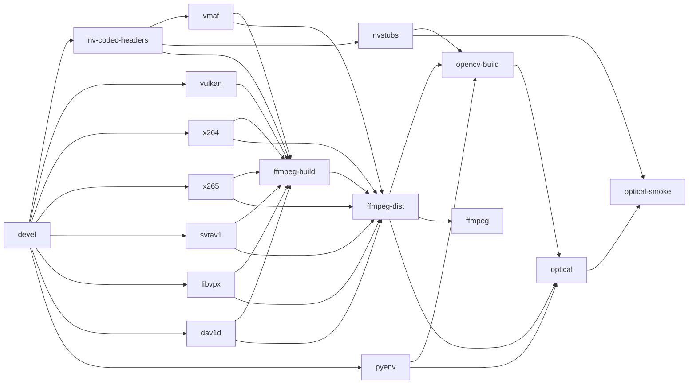

# Build

## Stages

- `devel` is `nvidia/cuda:*-devel-ubuntu24.04` plus build tools. Every library builds in its own stage
  and installs into `/out`, so BuildKit builds them in parallel and a version bump rebuilds only that
  library and the stages that consume it.
- `ffmpeg-dist` is a `scratch` stage holding FFmpeg and its shared codec libraries; both runtime
  images copy it, so the FFmpeg in `optical` is byte-identical to the one in `ffmpeg`.
- `ffmpeg` is based on `nvidia/cuda:*-base`: FFmpeg loads the driver libraries (`libcuda`,
  `libnvcuvid`, `libnvidia-encode`) at run time and needs no CUDA toolkit libraries.
- `optical` is based on `nvidia/cuda:*-runtime`, which provides the cuBLAS, cuFFT and NPP libraries
  OpenCV's CUDA modules link against.
- `optical-smoke` adds link stubs (see below) so `cv2` imports without a GPU; it is for CI only.
- The default target is `optical`.

## Build arguments

| Argument | Default | Use |
| --- | --- | --- |
| `CUDA_ARCH_BIN` | `7.5 8.6 8.9 9.0 12.0` | SASS arches compiled into OpenCV |
| `CUDA_ARCH_PTX` | `12.0` | PTX arches embedded for JIT on newer GPUs |
| `NV_CODEC_HEADERS_VERSION` | `13.0.19.1` | NVENC/NVDEC API (driver 570 or newer) |
| `VULKAN_SDK_VERSION` | `1.4.357.0` | Vulkan-Headers and glslang tag |
| `X264_COMMIT`, `X265_VERSION`, `SVTAV1_VERSION`, `LIBVPX_VERSION`, `DAV1D_VERSION`, `VMAF_VERSION` | see Dockerfile | codec libraries |
| `FFMPEG_VERSION` | `8.1.3` | FFmpeg release |
| `OPENCV_VERSION` | `4.14.0` | OpenCV and opencv_contrib |
| `NUMPY_VERSION` | `2.5.4` | numpy in `/opt/venv` |
| `TORCHCODEC_COMMIT` | see Dockerfile | source of the MIT-licensed `nvcuvid.h`/`cuviddec.h` |

The CUDA version is fixed by the `FROM nvidia/cuda:<version>-…` lines so Dependabot can update them;
change all three together.

## Notable choices

- x265 is built as the upstream multilib recipe: 10- and 12-bit static libraries linked into the 8-bit shared library.
- FFmpeg compiles its Vulkan shaders with glslang built from the same Vulkan SDK tag as the headers,
  which Ubuntu 24.04's packages are too old for. glslang is linked statically.
- libvmaf is built with CUDA, enabling FFmpeg's `libvmaf_cuda` filter.
- OpenCV's `cudacodec` needs the Video Codec SDK headers and links against `libnvcuvid` and
  `libnvidia-encode`. The headers come from an MIT-licensed copy (`nvEncodeAPI.h` from
  nv-codec-headers). The `nvstubs` stage generates link-only stub libraries for them and for
  `libcuda`. No NVIDIA driver files are copied into any image; the container toolkit
  mounts the real driver libraries at run time.
- `NVIDIA_DRIVER_CAPABILITIES=compute,utility,video,graphics` makes `--gpus` mount the NVENC/NVDEC,
  optical flow and Vulkan driver components.

## Licensing

FFmpeg is configured with `--enable-gpl` and never `--enable-nonfree`; libnpp and fdk-aac are not
used by FFmpeg. OpenCV is built with `OPENCV_ENABLE_NONFREE=OFF`. OpenCV's CUDA modules link against
NPP, cuBLAS and cuFFT from the NVIDIA CUDA runtime base image, distributed under NVIDIA's terms.
